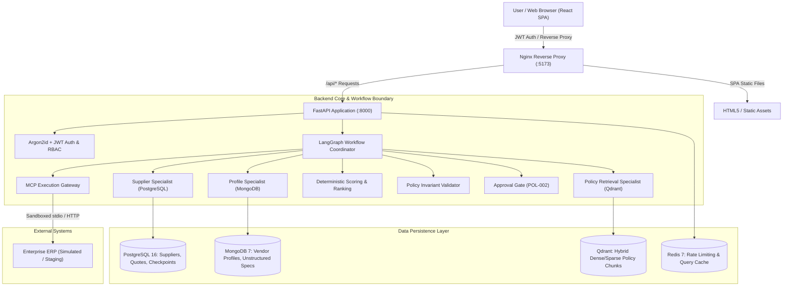
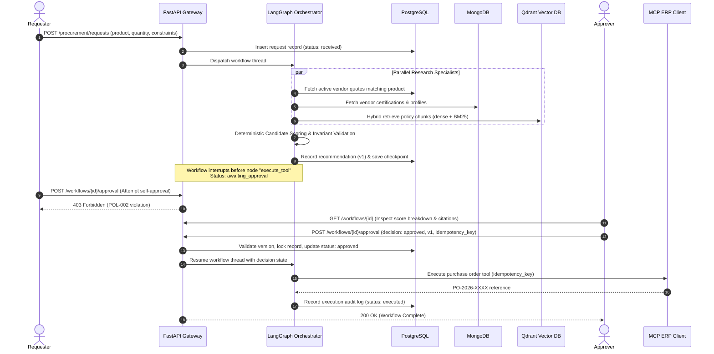

# System Architecture: Agentic Procurement Platform

## 1. Overview & Context

The Agentic Procurement Platform is a production-grade reference architecture for enterprise procurement. It balances autonomous information retrieval with deterministic governance, ensuring that language models **cannot** authorize financial commitments or bypass compliance policies.

---

## 2. Trust Boundaries & Security Enclaves

| Boundary | Untrusted Side | Trusted Side | Enforcement Mechanism |
|---|---|---|---|
| **Boundary 1: Client to API** | Web Browser / SPA | FastAPI Backend | JWT Bearer verification, rate limits (Redis sliding window), CORS isolation, input schema validation (Pydantic v2). |
| **Boundary 2: LLM to Business Rules** | Specialist Prompts / Model Outputs | Graph State & DB | Model never computes scores or authorises actions; candidates are ranked via deterministic math (`SCORING_VERSION 1.0`). |
| **Boundary 3: User to Approval (POL-002)** | Requester User | Approval Record | Requester cannot approve their own requests (`forbidden_self_approval`). Validated server-side on JWT subject comparison. |
| **Boundary 4: Approval to Execution** | LangGraph State | ERP Purchase Action | MCP tool execution requires an active approved state, matching recommendation version, and verified idempotency key. |

---

## 3. Data Ownership & Storage Rationale

| Store | Data Domain | Why This Specific Store? |
|---|---|---|
| **PostgreSQL 16** | Users, Suppliers, Quotations, Procurement Requests, Workflow Checkpoints, Execution Audit Logs. | ACID guarantees, relational joins between suppliers and quotes, foreign key integrity, row-level locking for concurrency, LangGraph checkpointer persistence. |
| **MongoDB 7** | Vendor profile extensions, ISO compliance documents, regional tax registrations. | Unstructured and evolving schema; different suppliers provide wildly different certificate hierarchies that don't fit fixed relational columns. |
| **Qdrant** | Internal corporate procurement policy chunks (`POL-001`, `POL-002`, `POL-003`). | Fast hybrid vector search (dense `bge-small-en-v1.5` + sparse `bm25`), reciprocal rank fusion (RRF), exact metadata payload filtering by effective dates and version. |
| **Redis 7** | Auth rate limiting, supplier query cache, distributed lock coordination. | Sub-millisecond sliding window rate limiting to protect auth endpoints; TTL-based cache for expensive supplier directory joins. |

---

## 4. LangGraph Workflow Execution & Approval Sequence

---

## 5. Architectural Decisions: Specialists vs Autonomous Agents

1. **Why Specialist Nodes instead of Autonomous Agents?**
   - Autonomous multi-agent loops introduce non-deterministic branching, uncontrolled latency, hallucinations of inventory numbers, and unpredictable financial exposure.
   - Specialist nodes have bounded tasks, explicit schemas, hard timeouts (8s), and clear fallback paths (fail-fast or abstain).
2. **Why Separated Execution Gateway (MCP)?**
   - Direct database updates from graph nodes bypass ERP invariants. By routing execution through a Model Context Protocol tool with explicit JSON schemas, ERP calls are sandboxed, auditable, and decoupled.
3. **Optimistic Concurrency Control:**
   - Every approval must submit the exact `recommendation_version` reviewed by the human. If a background supplier update recalculates candidate scores, the version increments to `v2`, and the stale approval is rejected with `409 Conflict`.
